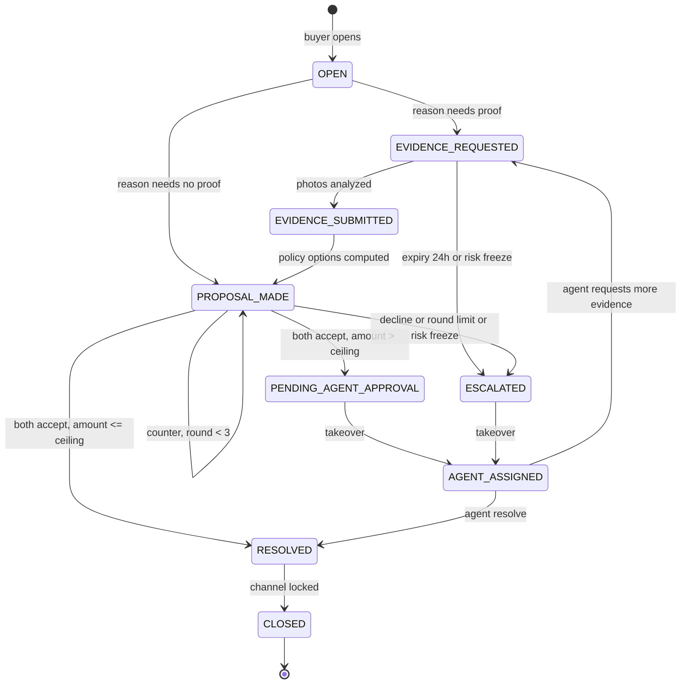
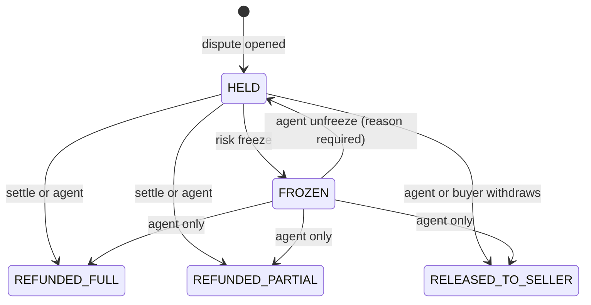

# Design.md: DisputeGuard AI

Domain logic that must behave identically every time. Everything here is deterministic code unless marked **(LLM)**.

---

## 1. Design stance

| Decision | Reason |
|---|---|
| DB is the source of truth; Nexconn is the live bus | Cards in chat can be lost or replayed; money state cannot |
| Writes go through REST, not through chat messages | Authorization, validation, idempotency, audit |
| LLM output is data to validate, never authority | Prompt injection and hallucination cannot move money |
| Outbox pattern for chat side effects | State change and card emission cannot diverge |
| Append-only escrow ledger | Every transition is explainable |

## 2. State machines

### 2.1 Dispute



Any state except `RESOLVED` and `CLOSED` can move to `ESCALATED` on a risk freeze.

### 2.2 Escrow



Guards
- Only `agent` role can move money out of `FROZEN`.
- Auto-settle (no agent) is allowed only from `HELD`, only when both parties accepted the same option, and only when amount is at or below `AUTO_APPROVE_CEILING_MINOR`.
- Every transition requires `actor_id`, `reason_code`, and writes a ledger row in the same transaction.
- Illegal transition returns 409 `INVALID_TRANSITION` with `from` and `to`.

### 2.3 Order status mapping

| Escrow outcome | Order status |
|---|---|
| `HELD` with open dispute | `disputed` |
| `REFUNDED_FULL` | `refunded` |
| `REFUNDED_PARTIAL` | `partially_refunded` |
| `RELEASED_TO_SELLER` | `completed` |

## 3. Domain model (tables)

```sql
create table users (
  id text primary key,                 -- = Nexconn user id, e.g. u_buyer_aiko
  name text not null,
  role text not null check (role in ('buyer','seller','agent','supervisor','bot')),
  lang text not null,                  -- BCP-47 primary subtag: ja, es, zh, en, hi, ar, de
  avatar text
);

create table orders (
  id text primary key,
  title text not null,
  image text,
  amount_minor bigint not null,
  currency char(3) not null,
  status text not null,
  delivered_at timestamptz,
  buyer_id text not null references users(id),
  seller_id text not null references users(id),
  category text not null default 'general'
);

create table disputes (
  id text primary key,
  order_id text not null unique references orders(id),
  channel_id text not null unique,
  reason text not null,
  status text not null,
  risk_score real not null default 0,
  risk_band text not null default 'low',
  frozen boolean not null default false,
  assigned_agent_id text references users(id),
  negotiation_round int not null default 0,
  policy_version text not null,
  opened_at timestamptz not null default now(),
  escalated_at timestamptz,
  resolved_at timestamptz
);

create table escrow_accounts (
  dispute_id text primary key references disputes(id),
  state text not null,
  amount_minor bigint not null,
  currency char(3) not null
);

create table escrow_ledger (            -- append only; no update, no delete
  id text primary key,
  dispute_id text not null references disputes(id),
  type text not null,                   -- hold|freeze|unfreeze|refund_full|refund_partial|release
  from_state text not null,
  to_state text not null,
  amount_minor bigint not null default 0,
  actor_id text not null,
  reason_code text not null,
  note text,
  created_at timestamptz not null default now()
);

create table evidence (
  id text primary key,
  dispute_id text not null references disputes(id),
  uploader_id text not null references users(id),
  status text not null,                 -- analyzing|done|failed
  files jsonb not null,                 -- [{key,w,h,phash}]
  assessment jsonb,
  integrity jsonb,                      -- {reusedImage, exifMismatch, matchedDisputeIds[]}
  captured_at timestamptz,
  created_at timestamptz not null default now()
);

create table proposals (
  id text primary key,
  dispute_id text not null references disputes(id),
  round int not null,
  options jsonb not null,
  buyer_response jsonb,                 -- {response, optionId, counterMinor}
  seller_response jsonb,
  status text not null,                 -- open|settled|countered|declined|expired
  policy_version text not null,
  created_at timestamptz not null default now()
);

create table observed_messages (        -- one row per chat message seen
  uid text primary key,                 -- Nexconn message uid
  dispute_id text not null references disputes(id),
  sender_id text not null,
  text text not null,
  lang text,
  ts bigint not null,
  analysis jsonb                        -- risk analysis output
);

create table translations (
  message_uid text not null,
  target_lang text not null,
  source_lang text,
  text text not null,
  tone_note text,
  primary key (message_uid, target_lang)
);

create table risk_events (
  id text primary key,
  dispute_id text not null references disputes(id),
  message_uid text,
  type text not null,                   -- chargeback|legal|police|scam_accusation|violence|frustration|masking
  confidence real not null,
  score_after real not null,
  fired_freeze boolean not null default false,
  created_at timestamptz not null default now()
);

create table agent_actions (            -- audit
  id text primary key,
  dispute_id text not null references disputes(id),
  agent_id text not null,
  action text not null,
  payload jsonb not null,
  override boolean not null default false,
  created_at timestamptz not null default now()
);

create table briefs (
  dispute_id text primary key references disputes(id),
  body jsonb not null,
  generated_at timestamptz not null default now()
);

create table outbox (
  id bigserial primary key,
  dispute_id text,
  channel_id text not null,
  from_user text not null,
  envelope jsonb not null,
  sent_at timestamptz,
  attempts int not null default 0
);

create table idempotency (
  key text primary key,
  route text not null,
  body_hash text not null,
  response jsonb not null,
  created_at timestamptz not null default now()
);
```

## 4. Claim detection and routing

Inputs: selected `reason`, free text of first message.
Rules, in order:

1. If the buyer chose a reason, use it.
2. Otherwise **(LLM)** classify the first message into one of the four reasons or `other`. Output validated by Zod. On `other`, the bot asks the buyer to pick a reason via a quick-reply card.
3. Route: `damaged` and `wrong_item_or_size` require evidence; `not_received` runs a tracking check against seeded shipment data; `not_as_described` requires evidence plus a listing comparison text.

Evidence request expires in 24 hours (demo mode: configurable to 5 minutes). Expiry escalates.

## 5. Policy engine (deterministic)

### 5.1 Inputs
`reason`, `severity` (0 to 3, from vision or buyer-asserted when no photo), `order.amount_minor`, `order.category`, `policy_version`.

### 5.2 Policy table v1 (editable JSON, versioned)

```json
{
  "version": "v1",
  "autoApproveCeilingMinor": 5000,
  "reasons": {
    "damaged": {
      "severity": {
        "0": { "options": [] , "escalate": true },
        "1": { "options": [
          { "id": "opt_keep_small", "title": "Keep item, small refund", "refundPct": 15, "returnRequired": false }
        ]},
        "2": { "options": [
          { "id": "opt_keep_partial", "title": "Keep item, partial refund", "refundPct": 40, "returnRequired": false },
          { "id": "opt_replace", "title": "Replacement sent", "refundPct": 0, "returnRequired": false, "replacement": true }
        ]},
        "3": { "options": [
          { "id": "opt_full_return", "title": "Full refund on return", "refundPct": 100, "returnRequired": true },
          { "id": "opt_full_keep", "title": "Full refund, keep item", "refundPct": 100, "returnRequired": false, "maxOrderMinor": 3000 }
        ]}
      }
    },
    "wrong_item_or_size": {
      "default": { "options": [
        { "id": "opt_exchange", "title": "Exchange, seller pays shipping", "refundPct": 0, "returnRequired": true, "replacement": true },
        { "id": "opt_refund_return", "title": "Full refund on return", "refundPct": 100, "returnRequired": true },
        { "id": "opt_keep_discount", "title": "Keep item, 20% refund", "refundPct": 20, "returnRequired": false }
      ]}
    },
    "not_received": {
      "default": { "options": [
        { "id": "opt_reship", "title": "Seller reships", "refundPct": 0, "replacement": true },
        { "id": "opt_refund_full", "title": "Full refund", "refundPct": 100 }
      ]},
      "ifTrackingDelivered": { "escalate": true }
    },
    "not_as_described": {
      "default": { "options": [
        { "id": "opt_partial_20", "title": "Keep item, 20% refund", "refundPct": 20 },
        { "id": "opt_refund_return", "title": "Full refund on return", "refundPct": 100, "returnRequired": true }
      ]}
    }
  },
  "counterBounds": { "minPctOfOption": 50, "maxPctOfOption": 150, "hardMaxPctOfOrder": 100 },
  "maxRounds": 2
}
```

These percentages are demo-grade policy values, not industry benchmarks. Say so in the write-up.

### 5.3 Option generation and bounds

```ts
function buildOptions(ctx): Option[] {
  const cfg = lookup(policy, ctx.reason, ctx.severity);
  if (cfg.escalate) return [];                         // caller escalates
  return cfg.options
    .filter(o => !o.maxOrderMinor || ctx.order.amountMinor <= o.maxOrderMinor)
    .map(o => ({
      id: o.id, title: o.title,
      refundMinor: Math.round(ctx.order.amountMinor * o.refundPct / 100),
      returnRequired: !!o.returnRequired, replacement: !!o.replacement,
      rationale: rationale(ctx, o),                    // template string, no LLM
    }));
}

// counter bounds
function validCounter(option, counterMinor, order) {
  const lo = option.refundMinor * policy.counterBounds.minPctOfOption / 100;
  const hi = Math.min(option.refundMinor * policy.counterBounds.maxPctOfOption / 100,
                      order.amountMinor);
  return counterMinor >= lo && counterMinor <= hi;
}
```

Rationale strings are templates (for example "Cracked rim, severity 2 of 3: policy v1 suggests 40% with item kept"). Templates are localized per recipient language at render time through the translate path, or pre-authored in en/ja/es/zh.

### 5.4 Proposal lifecycle

1. Policy builds options, proposal row created, round = previous + 1.
2. Each party responds once per round: accept(option), counter(option, amount), decline.
3. Resolution logic:
   - Both `accept` same option: settle (or pending approval above ceiling).
   - One `counter` and other `accept` same option: counter amount is offered to the accepting party as new round; if round limit reached, escalate.
   - Any `decline`: escalate immediately with decline reasons recorded.
   - Both counter: round + 1, options re-issued as midpoint **only if** midpoint lies in policy bounds; otherwise escalate.
4. After `maxRounds` unresolved: escalate.
5. Expiry 48 hours (demo: 10 minutes).

## 6. Escalation Firewall: risk algorithm

### 6.1 Per-message analysis **(LLM, structured)**
Output per message (full schema in `AI_PROMPTS.md`):

```ts
type RiskAnalysis = {
  lang: string;
  frustration: number;          // 0..1, true intent not surface politeness
  surfaceTone: 'polite'|'neutral'|'angry';
  politenessMasking: boolean;   // polite surface, high frustration beneath
  threat: { type: 'none'|'chargeback'|'legal'|'police'|'scam_accusation'|'violence'; confidence: number; negated: boolean; quoted: boolean };
  scamSignals: string[];        // e.g. 'asks to move payment off-platform'
  quote_en: string;             // short English gloss of the triggering span
};
```

### 6.2 Lexicon pre-check (code)
Small multilingual keyword set (en, ja, zh, es, hi, ar, de) maps to threat types. Used for two things only: (a) a floor on `threat.confidence` when the lexicon hits and the LLM disagrees by more than 0.4 (log a disagreement), (b) a fast path if the LLM is unavailable. Lexicon alone never freezes; it sets `AI_UNAVAILABLE` degraded mode flagged for agent review.

### 6.3 Dispute risk score

```ts
const w = { frustration: 0.6, prev: 0.4 };
const msgRisk = Math.max(
  analysis.frustration * (analysis.politenessMasking ? 1.0 : 0.9),
  threatWeight(analysis.threat)              // 0 if negated/quoted; else map below
);
score = clamp(w.frustration * msgRisk + w.prev * prevScore, 0, 1);
// threatWeight: chargeback .8, legal .85, police .85, scam_accusation .8, violence 1.0, none 0
// scaled by threat.confidence
```

Decay: if a message has `frustration < 0.2` and no threat, `score = score * 0.85` to let de-escalation register.

### 6.4 Freeze rule

Freeze if any of:

1. `threat.type in {chargeback, legal, police, scam_accusation}` and `confidence >= 0.6` and not negated and not quoted
2. `threat.type == violence` and `confidence >= 0.5` (freeze and flag `safety`)
3. `score >= 0.8`
4. Two consecutive messages from the same sender with `frustration >= 0.65`

On freeze, in one transaction:
- `disputes.frozen = true`, `status = ESCALATED`, `risk_band = high`
- escrow `HELD` to `FROZEN` ledger row, reason `risk_freeze`
- `risk_events` row with the triggering type
- outbox: `card.escalation_notice` (audience `all`, text in each participant language, **no risk details**), `card.escrow_status`, ops `evt.queue_delta`
- async: generate brief

Scam signals (for example "pay me outside the platform") do not freeze by themselves but raise priority and add a visible agent flag. Unless confidence is high and the sender is the seller, in which case rule 1 behavior applies with type `scam_accusation` replaced by `off_platform_payment` (add to threat enum).

### 6.5 False positive controls
- Negation and quoting are explicit model outputs and also tested in the eval set.
- Agents can unfreeze with a reason; unfreeze lowers `prevScore` to 0.4 and records a training label.
- The firewall never blocks messages from being sent.

## 7. Evidence pipeline

1. Upload to private storage; reject non-images.
2. Downscale to 1280 px long edge; strip nothing before hashing.
3. Compute perceptual hash (pHash 64-bit) per image. Query other disputes for Hamming distance <= 6: matches set `integrity.reusedImage` and list `matchedDisputeIds` (agents only).
4. EXIF check: if EXIF timestamp exists and predates `order.delivered_at` by more than 24 hours, set `exifMismatch`. Missing EXIF is neutral (screenshots, HEIC conversion).
5. **(LLM vision)** structured assessment (`AI_PROMPTS.md` section 4).
6. Severity mapping to policy: model's 0 to 3 is used as is, but if confidence < 0.5 or image quality issues present, the bot asks for one retake before building a proposal. Second low-confidence result escalates with note "evidence unclear".
7. Result card posted to chat with label "AI-assessed, not verified".

What the assessment cannot do: prove an image shows the delivered item, prove when damage occurred, or detect skilled manipulation. State this in the write-up; the human gate above the ceiling exists because of it.

## 8. Queue priority

```ts
priority =
    100 * riskScore
  + 20  * (frozen ? 1 : 0)
  + 0.5 * minutesWaiting          // capped at 120
  + 10  * min(amountMinor / 20000, 1)
  + 15  * (safetyFlag ? 1 : 0)
  + 5   * (scamFlag ? 1 : 0);
```

Sorted descending. `risk band` color derives from `riskScore`, with icon and text label as well as color.

## 9. Brief generation **(LLM, strong model)**

Inputs assembled by code (never the raw database): last 30 observed messages with translations to the agent language, evidence assessment, order facts, policy options, risk events. Output validated JSON (see `API.md` `/brief`). The recommended action is computed by code from policy and evidence; the LLM writes only the narrative fields. Brief regenerates when new messages arrive and the agent opens the case, with a 60-second cache.

## 10. Copilot draft **(LLM, fast model)**

Inputs: target party, target language, intent, order facts, policy option(s) in force, last 6 messages. Constraints in the prompt: do not promise amounts not present in the policy options, do not admit liability, short, polite, in target language, plus English preview. Output validated; amounts mentioned in the draft are regex-checked against allowed amounts, and any mismatch raises `warnings` and highlights in the UI.

## 11. Audit and compliance of actions

- `agent_actions` row for every agent POST.
- Overrides (`override: true`) flagged and surfaced in supervisor metrics.
- `escrow_ledger` is insert-only; enforce with a DB rule or by omitting update/delete grants for the app role.

## 12. Seed data (must exist for demo and tests)

| Order | Buyer | Seller | Item | Amount | Category |
|---|---|---|---|---|---|
| `ord_1042` | Aiko (ja) | Marco (es) | Ceramic pour-over set | 84.00 USD | home |
| `ord_1043` | Sofia (es) | Li Wei (zh) | Wireless earbuds | 129.00 USD | electronics |
| `ord_1044` | Aiko (ja) | Li Wei (zh) | Silk scarf, size M ordered, L sent | 56.00 USD | apparel |
| `ord_1045` | Sofia (es) | Marco (es) | Olive oil gift set, not received | 42.00 USD | food |

Delivered dates are relative to seed time so "delivered 3 days ago" always holds.
