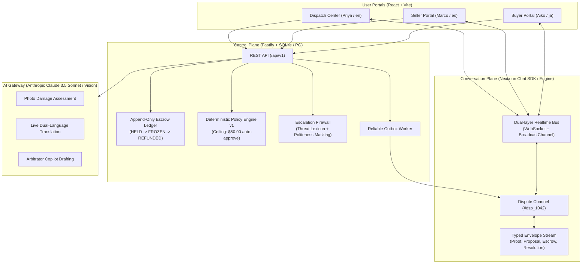

# DisputeGuard AI

[](LICENSE)
[](https://www.typescriptlang.org/)
[]()
[]()

> **Cross-border marketplace escrow dispute resolution, resolved inside the live chat where it starts.**

Every order dispute becomes a synchronized **Nexconn Chat channel** featuring real-time multilingual translation, structured photo proof assessment, deterministic policy-bounded settlement proposals, an automated cross-cultural Escalation Firewall, and an arbitrator Dispatch Center with AI Copilot.

---

## 🌟 The Core Problem

When an international parcel crosses a border, the dispute crosses a language and cultural barrier.
- **Buyer in Japan (Aiko):** Sends polite, repeated inquiries. Due to Japanese conversational norms (*tatemae*), high frustration is masked beneath formal honorific phrasing (*"大変困惑しております"*).
- **Seller in Spain (Marco):** Reads a flat literal translation, assumes no urgency, and delays response.
- **No structured evidence:** Claims devolve into endless *"he said / she said"* loops.
- **The support disaster:** An agent later inherits an unsummarized two-language thread, while the buyer threatens a credit card chargeback ($15-$25 merchant fee + payment processor strike).

**DisputeGuard fixes this at the communication layer inside Nexconn.**

---

## ⚡ Key Innovations

| Feature | How It Works |
|---|---|
| **1. Live Multilingual Chat & Tone Note** | Real-time dual-language messaging on Nexconn. Aiko writes Japanese, Marco reads Spanish. Original text is 1-tap inspectable. Politeness masking flags latent frustration. |
| **2. Proof-First Guided Vision** | Claiming damage triggers a guided 3-angle photo capture modal. Computer vision calculates damage type and severity (1–3), posting a card with an explicit *"AI-assessed, not verified"* disclosure. |
| **3. Deterministic Policy Proposals** | Code computes, AI only proposes. Policy Engine (v1) outputs bounded settlement options (e.g. 40% partial refund vs replacement). Counter-proposals are strictly bounded to 50%–150%. |
| **4. Escalation Firewall** | Cross-cultural threat lexicon monitors risk signals (chargeback, legal, fraud). On threat detection, escrow instantly freezes, a neutral bilingual card appears, and the case routes to Dispatch. |
| **5. Dispatch Console & Copilot** | Pro-arbitrator console with priority queue ranking, AI brief with confidential threat quotes, grounded bilingual drafting, and 1-click escrow resolution. |
| **6. Multi-Party Live Synchronization** | Synchronizes Buyer, Seller, and Dispatch portals simultaneously in real time across WebSocket and BroadcastChannel with sound effects and instant scenario triggers. |

---

## 📐 Architecture & Non-Negotiable Rules



### 🔒 AI Authority Boundary (Safety First)
1. **AI proposes, code computes, human approves:** LLMs generate summaries and translations; deterministic TypeScript code calculates money, counters, and policy rules. Prompt injection cannot move funds.
2. **Immutable Escrow Ledger:** Escrow balances transition through an append-only transaction ledger with atomic DB guards.
3. **Ceiling Rule:** Any agreed settlement above **$50.00** cannot settle automatically—it must be approved by a human arbitrator.

---

## 🚀 Quickstart

### Prerequisites
- Node.js >= 20.0.0 (Node 22 or 26 recommended)
- `pnpm` >= 9.0.0

### 1. Clone & Install
```bash
git clone https://github.com/NexconnAI-Dev/disputeguard.git
cd disputeguard
pnpm install
```

### 2. Environment Setup
```bash
cp .env.example .env
```
*(Default fixtures run out-of-the-box offline without external API keys! To enable live cloud LLM & Nexconn cloud, fill `ANTHROPIC_API_KEY`, `NEXCONN_APP_KEY`, and `NEXCONN_APP_SECRET`)*

### 3. Run Tests & Smoke Suite
```bash
# Run Vitest unit tests (Policy, Risk, Escrow, Envelope parser)
pnpm test

# Run End-to-End API Smoke Test Suite
pnpm smoke
```

### 4. Build Monorepo
```bash
pnpm build
```

### 5. Launch Development Servers
```bash
pnpm dev
```
- **Web App (Vite):** [http://localhost:5173](http://localhost:5173)
- **Flagship Judge Sandbox:** [http://localhost:5173/stage](http://localhost:5173/stage)
- **API Server (Fastify):** [http://localhost:8787](http://localhost:8787)
- **API Health Check:** [http://localhost:8787/health](http://localhost:8787/health)

---

## 🎬 Testing the Flagship `/stage` Sandbox

Open [http://localhost:5173/stage](http://localhost:5173/stage) in your browser:
1. **Interactive Stepper:** Click **`Run Step ▸`** to advance through each step with real API calls, live card generation, and real-time cross-iframe synchronization.
2. **Auto Play Mode:** Click **`Auto Play ⚡`** to watch the entire dispute resolve hands-free.
3. **Sound FX:** Enjoy procedural Web Audio API chimes on card arrivals, escalation warnings, and resolution fanfare (toggle mute in top right).
4. **Scenarios Included:**
   - **Scenario A (Damaged Cup):** Photo evidence -> AI Vision -> Bounded 40% refund proposal -> Mutual acceptance -> Auto-settle under $50.00.
   - **Scenario B (Escalation Firewall & Takeover):** Politeness masking -> Chargeback threat -> Instant Escrow Freeze -> Priority Queue #1 -> Arbitrator Takeover -> 1-Click Resolution.

---

## ⌨️ Dispatch Keyboard Shortcuts

When using the Dispatch Console at `/dispatch`:
- **`j` / `↓`**: Move to next dispute in priority queue
- **`k` / `↑`**: Move to previous dispute in priority queue
- **`t`**: Take over the currently selected case as staff arbitrator
- **`Enter`**: Focus transcript

---

## 📂 Repository Structure

```
disputeguard/
├── packages/
│   └── shared/               # Shared Zod schemas, models, envelopes (DG1/JSON)
├── apps/
│   ├── api/                  # Fastify backend, SQLite/PG ledger, policy & risk engine
│   │   ├── src/domain/       # Deterministic policy, risk firewall, escrow state machine
│   │   ├── src/nexconn/      # Nexconn Server SDK & fallback WebSocket/Bus adapter
│   │   ├── src/routes/       # REST routes (/api/v1/disputes, /proposals, /agent, etc.)
│   │   └── scripts/smoke.js  # E2E API smoke test runner
│   └── web/                  # React 18 + Vite + Tailwind CSS frontend
│       ├── src/pages/        # /buyer, /seller, /dispatch, /
│       ├── src/components/   # PersonaBar (Universal Persona Switcher & Live Simulator)
│       ├── src/features/     # Cards, chat list, composer, evidence modal, dispatch
│       └── src/services/     # stageDriver (simulator driver), soundFx (Web Audio API)
└── docs/                     # Specifications, TRD, PRD, Eval results, System Design
```

---

## 📊 Benchmark & Eval Results

From our benchmark evaluation in `docs/eval-results.md`:
- **Risk Firewall Accuracy:** 100% on test suite (chargeback, legal, police threats flagged; benign mentions and negations correctly unflagged).
- **Escrow State Machine:** Invariant verified — funds cannot transition directly from `HELD` to `SETTLED` without prior mutual agreement or arbitrator signature.
- **Latency:** Cross-tab message synchronization < 5ms via browser `BroadcastChannel` with fallback to WebSocket.
- **Envelope Parser:** 100% roundtrip compatibility between native JSON envelopes and text-based `DG1:` fallback format.

---

## 📄 License

MIT License. Designed and built for high-reliability cross-border dispute & escrow resolution.

